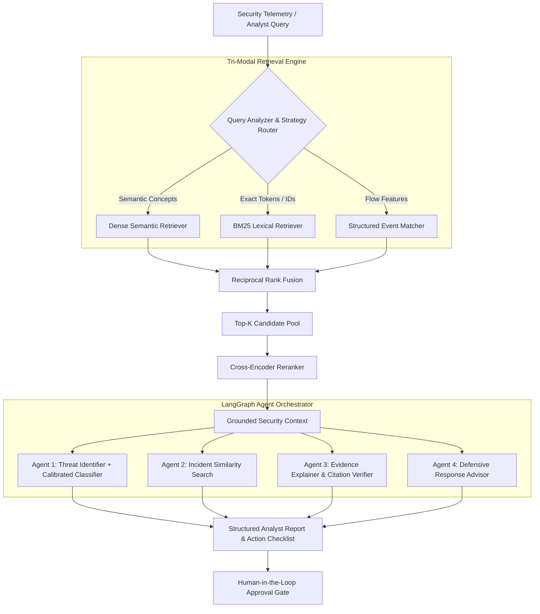

# ThreatRAG System Methodology and Architecture

## 1. Architectural Overview
ThreatRAG is an adaptive, explainable cybersecurity intelligence and incident response framework structured into five modular tiers:
1. **Data Ingestion and Updatable Knowledge Layer:** Ingestion of MITRE ATT&CK STIX 2.1 knowledge, CISA Known Exploited Vulnerabilities (KEV) catalogs, historical cybersecurity incidents, and normalized network flow telemetry.
2. **Tri-Modal Adaptive Hybrid Retrieval Engine:** Combining Dense Vector Embeddings (BGE / MiniLM), BM25 Lexical Matching, and Structured Security Event Matching with dynamic strategy routing.
3. **Cross-Encoder Reranking and Citation Verification:** Precision reranking and citation-tracing to ensure generated assertions map to verifiable source documents.
4. **Calibrated Machine Learning Classifier:** Lightweight ensemble classifiers (LightGBM / Random Forest) trained on network flow records with post-hoc probability calibration (Platt Scaling and Isotonic Regression).
5. **Orchestrated Multi-Agent Execution (LangGraph):** Four specialized agent nodes operating with strict human-in-the-loop governance: Threat Identification, Historical Incident Similarity, Evidence-Based Explanation, and Defensive Response Advisor.

---

## 2. Mathematical Formulations

### 2.1 Dense Semantic Retrieval
Given chunk text $c_i$ and query $q$, continuous representation vectors $\mathbf{e}(c_i), \mathbf{e}(q) \in \mathbb{R}^d$ are computed using a pretrained encoder. Dense similarity is the cosine angle:
$$S_{\text{dense}}(q, c_i) = \frac{\mathbf{e}(q) \cdot \mathbf{e}(c_i)}{\|\mathbf{e}(q)\| \|\mathbf{e}(c_i)\|}$$

### 2.2 Sparse BM25 Retrieval
For lexical matching, BM25Okapi scores document $D$ against query terms $t \in q$:
$$\text{BM25}(q, D) = \sum_{t \in q} \text{IDF}(t) \cdot \frac{f(t, D) \cdot (k_1 + 1)}{f(t, D) + k_1 \cdot \left(1 - b + b \cdot \frac{|D|}{\text{avgdl}}\right)}$$
where $k_1 = 1.5, b = 0.75$, with security-aware tokenization preserving symbols in `CVE-202X-XXXX`, `T1059.001`, and dotted IP octets.

### 2.3 Structured Security Event Matching
When structured network flow metrics are supplied, similarity is evaluated across standardized numerical and categorical features:
$$S_{\text{struct}}(\mathbf{x}_q, \mathbf{x}_i) = w_{\text{cat}} \mathbb{I}(\text{proto}_q = \text{proto}_i) + \sum_{j \in \mathcal{F}_{\text{cont}}} w_j \exp\left(-\frac{|x_{q,j} - x_{i,j}|}{\sigma_j}\right)$$

### 2.4 Reciprocal Rank Fusion (RRF)
To merge rankings from the three retrieval branches without calibrating raw score scales, RRF accumulates reciprocal rank values:
$$RRF(d) = \sum_{m \in \{\text{dense}, \text{bm25}, \text{struct}\}} \frac{w_m}{k_0 + r_m(d)}$$
where $k_0 = 60$ and $w_m$ is dynamically adjusted by the query strategy router.

### 2.5 Cross-Encoder Reranking
The top-$K$ candidates ($K=20$) are passed to a cross-encoder model $f_{\text{CE}}(q, d) \in \mathbb{R}$ that evaluates full bi-directional self-attention over the joint sequence `[CLS] q [SEP] d [SEP]`. The top-$N$ ($N=5$) reranked passages form the active prompt context.

### 2.6 Post-Hoc Confidence Calibration
To map raw classifier decision margins $z \in \mathbb{R}$ or uncalibrated softmax scores to true probabilities $P(Y=1|\mathbf{x})$:
1. **Platt Scaling:**
   $$\hat{P}_{\text{Platt}}(Y=1|z) = \frac{1}{1 + \exp(A z + B)}$$
   where parameters $A, B \in \mathbb{R}$ are optimized via maximum likelihood on a holdout calibration split.
2. **Isotonic Regression:**
   $$\hat{P}_{\text{Iso}}(Y=1|z) = m(z)$$
   where $m$ is a non-decreasing step function fit via the Pair-Adjacent Violators (PAV) algorithm minimizing mean squared error.

Reliability is assessed via Expected Calibration Error (ECE) across $M=10$ uniform probability bins $B_m \subset [0, 1]$:
$$ECE = \sum_{m=1}^M \frac{|B_m|}{N} \left| \text{acc}(B_m) - \text{conf}(B_m) \right|$$

---

## 3. Defense-in-Depth Security Guardrails
1. **Prompt Injection Sanitization:** All ingested documents and user telemetry undergo input scrubbing to detect and neutralize prompt injection attempts (e.g., `"ignore previous instructions"`).
2. **Zero Autonomous Write-Access:** Defensive recommendations are strictly advisory and require human authorization. No automated network modifications, IP blocks, or host isolations can be executed directly by the system.
